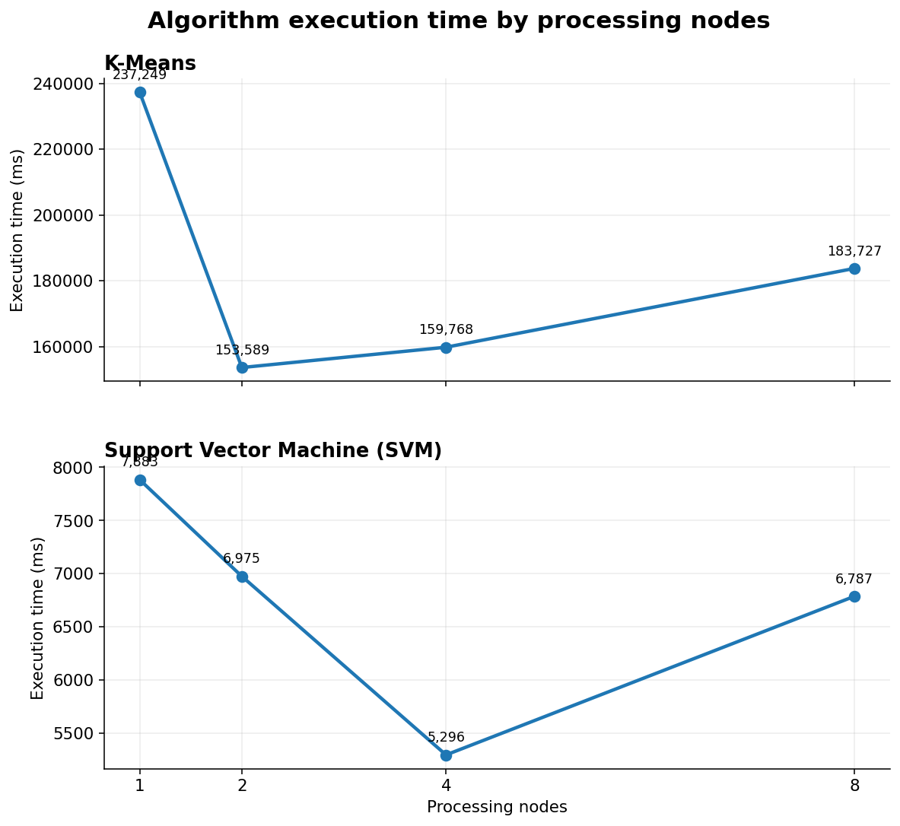
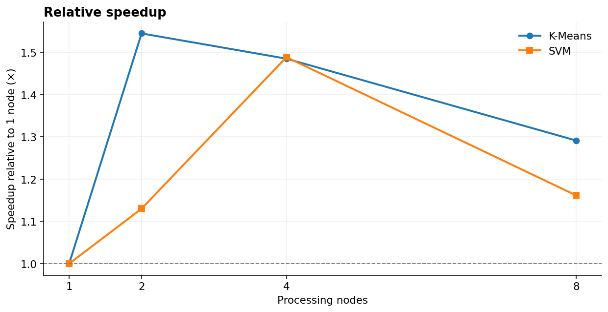
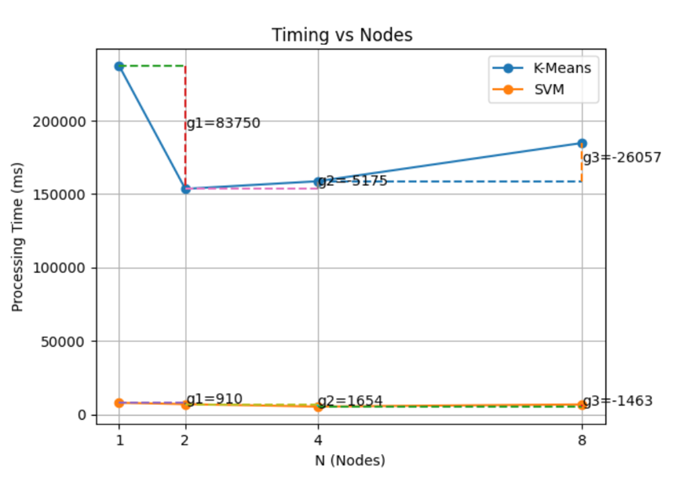
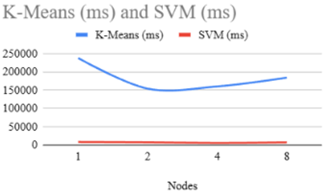
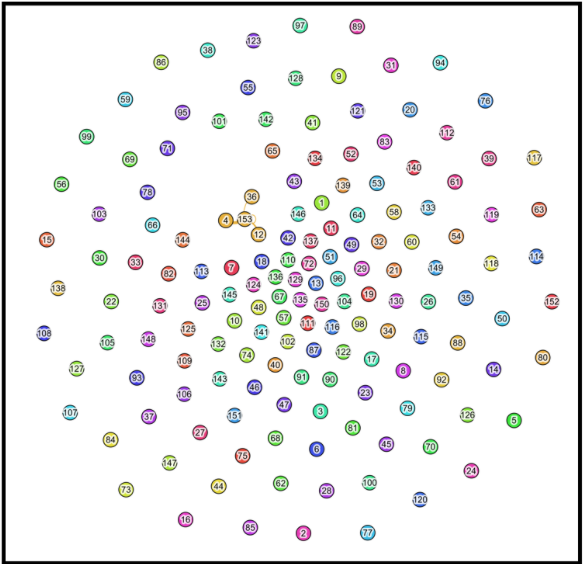

# Machine Learning & Social Network Analysis

**Data Science course project | Toronto Metropolitan University**

An experimental study of machine learning runtime, data parallelization and recommendation-driven social network connectivity. I used the existing **DSMP Social Network Simulator** to configure experiments, collect measurements, produce visualizations and interpret the results. This repository documents **my analysis**, not a new implementation of the simulator or its ML algorithms.

## At a glance

| Area | Experiment | Dataset / scope | Tools |
| :--- | :--- | :--- | :--- |
| Parallel ML benchmarking | Compare K-Means and SVM execution times across 1, 2, 4 and 8 nodes | Provided 57k dataset | DSMP Simulator, charts |
| Social network analysis | Observe Doc2Vec-based recommendations and inspect the exported network | Provided `Retail.txt` dataset, 153 nodes | DSMP Simulator, Gephi |

## 1. Parallel ML benchmarking

I ran both algorithms with four processing-node configurations and recorded execution times displayed by the simulator. The results describe **execution time**, not model accuracy.

### Recorded results

| Nodes | K-Means (ms) | SVM (ms) | K-Means speedup | SVM speedup |
| ---: | ---: | ---: | ---: | ---: |
| 1 | 237,249 | 7,883 | 1.00× | 1.00× |
| 2 | 153,589 | 6,975 | 1.54× | 1.13× |
| 4 | 159,768 | 5,296 | 1.49× | 1.49× |
| 8 | 183,727 | 6,787 | 1.29× | 1.16× |

The underlying measurements are in [`data/benchmark-results.csv`](data/benchmark-results.csv). Speedup is calculated as `T(1) / T(N)`.

### Recreated visualizations

The charts below were generated **from the recorded table**, not from new simulator runs. The algorithms are shown on separate axes because their execution times differ substantially.





### Original coursework graphs

These are the **original charts** retained as historical evidence of the analysis, without editing their annotations.





> **Chart note:** Some gain annotations on the original graph do not exactly match subtraction from the recorded execution-time table. For example, the original K-Means 1-to-2-node annotation is 83,750 ms, while the table implies 83,660 ms. Recreated charts and calculations use the tabulated measurements. The original image is preserved unchanged.

### Findings

- **K-Means:** Fastest observed configuration was **2 nodes** (153,589 ms), a **35.3% decrease** from one node.
- **SVM:** Fastest observed configuration was **4 nodes** (5,296 ms), a **32.8% decrease** from one node, or approximately **1.49× speedup**.
- Additional nodes did not consistently reduce execution time. Communication and synchronization overhead may contribute, but the experiment did not measure that overhead separately.
- SVM had lower runtime in these simulator configurations, but these results alone do not establish that SVM is a more accurate or generally superior model.

## 2. Recommendation-driven social network analysis

I used the simulator's **Doc2Vec** recommendation option with the supplied `Retail.txt` dataset, ran the experiment on one processing node and inspected the exported network in **Gephi**.

### Network visualization



### Recorded Gephi statistics

| Network metric | Reported value |
| :--- | ---: |
| Nodes | 153 |
| Edges | 2 |
| Average degree | 0.026 |
| Connected components | 151 |
| Network diameter | 2 |
| Average path length | 1.333 |

The exported graph was sparse, with most nodes isolated. This experiment illustrates how recommendation-based edges can change network connectivity.

> **Data limitation:** The original write-up describes three users connected to user 153, but its Gephi summary reports two edges. The table reproduces the Gephi statistics; this inconsistency has not been independently resolved. No graph topology was fabricated to reconcile it.

## Repository contents

```text
.
├── README.md
├── PORTFOLIO.md
├── data/
│   └── benchmark-results.csv
├── scripts/
│   └── plot_benchmarks.py
└── assets/
    ├── execution-time.png
    ├── speedup.png
    ├── original-timing-gains.png
    ├── original-timing-comparison.png
    └── gephi-network.png
```

To recreate the polished charts from the CSV, run `python scripts/plot_benchmarks.py` with `matplotlib` installed.

## Attribution

The **DSMP Social Network Simulator** and its algorithm implementations were developed by their original contributors. I did **not** develop or train these algorithms or build the distributed simulator. My contributions were running the experiments, collecting timings, creating charts, using Gephi and interpreting the findings.

**Original simulator:** [d-ibanescu/SocialNetworkSimulatorV3.1](https://github.com/d-ibanescu/SocialNetworkSimulatorV3.1)

These findings are specific to the course-provided datasets and tested simulator settings.
